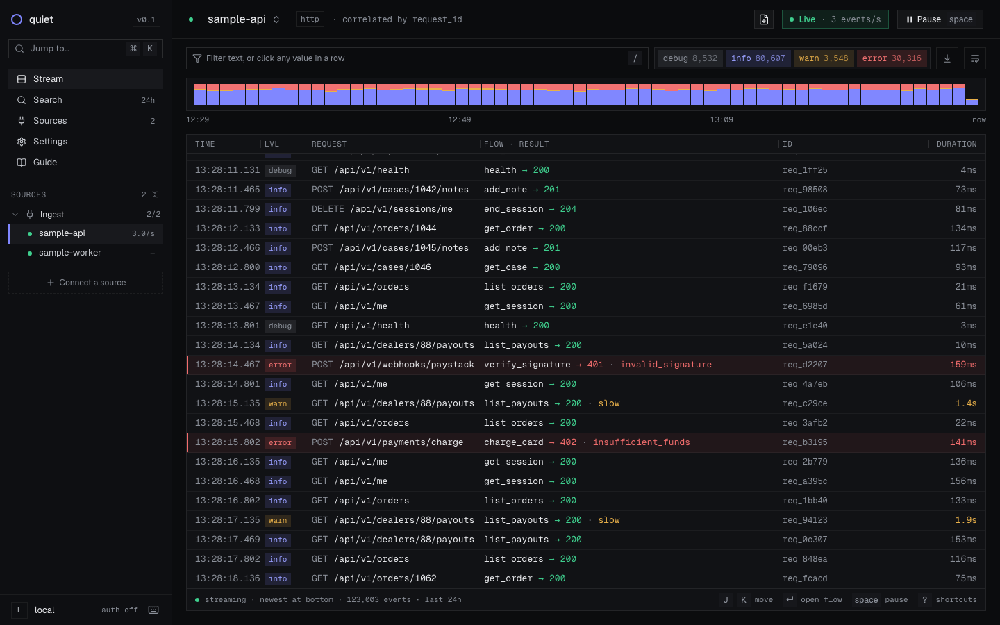
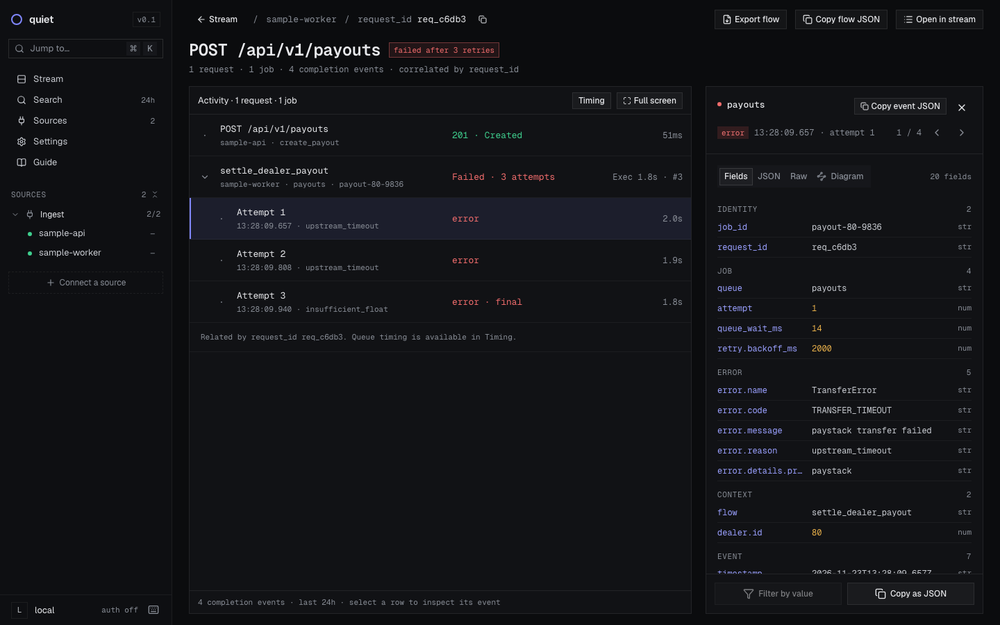

# quiet

**A calm, self-hosted log viewer for canonical events.** Pick one source, watch only its events, and open any of them as a flow: the request, the jobs it started and every retry, in one place.

quiet is one Rust binary with the web UI built in. It runs on a single host, reads every container on the local Docker socket, and takes pushes from Vector, Fluent Bit, OpenTelemetry and curl. No query language to learn, no dashboards to build.



**Status:** [v0.1.0](https://github.com/qwamicodes/quiet-telemetry/releases/tag/v0.1.0) is released. v0.1.1 (canonical events, redaction before storage, retained history) is in progress: see the [CHANGELOG](CHANGELOG.md) and the [v0.1.1 plan](docs/v0.1.1-plan.md).

## What you get

- **Stream.** One source at a time, live over a WebSocket. Each row reads `flow · METHOD path → status_code` with why it failed, level chips, a volume histogram, filters you click into, pause, and keyboard navigation.
- **Flows.** Every event that shares a `request_id`, `job_id` or trace id, stitched across sources. A flow opens as an activity list (requests, jobs, attempts, retries) with the field card beside it; **Timing** shows the timeline and graph, and OTLP spans form a span tree.
- **Search and export.** Free text plus `key:value` filters over the searchable window (24h by default, up to 7 days), grouped by flow. Export NDJSON, JSON or CSV, gzip it, or copy a curl command.
- **Sources and Connect.** Docker containers appear on their own, grouped by Compose project or Swarm stack. Connect a source walks you through Vector, Fluent Bit, OpenTelemetry or a file, with an ingest token filled in.
- **Guide and Check my logs.** A copyable prompt for your coding agent that instruments your app for good flows, and a scorecard that checks a source's recent events against it.
- **Redaction before storage.** Passwords, tokens, auth headers, cookies, JWTs and private keys become `[REDACTED]` before anything is stored, searched or exported. Add your own keys per source.
- **Muted lines.** Hide health checks and other noise per source or everywhere, without deleting anything.
- **Accounts.** An owner and members, copy-link invites, sessions, reset links. Every page needs sign-in.
- **Phones.** A bottom tab bar, a card stream and a flow view sized for small screens.



## Quick start

You need Docker, Git and make.

```sh
git clone https://github.com/qwamicodes/quiet-telemetry.git
cd quiet-telemetry
make up
```

Open http://127.0.0.1:7070 and create the owner account. A sample API and worker start sending events right away, and any other container on your machine shows up too. `make down` stops it.

Working on quiet itself? You also need Bun and Rust:

```sh
(cd web && bun install)
make dev       # server on :7070, UI with hot reload on :5173
make sample    # second terminal: sample events
```

The full setup, troubleshooting and release flow are in [docs/development.md](docs/development.md).

## Connect your apps

**Containers on the same host** need nothing: quiet reads their stdout through the Docker socket. Optional labels:

```yaml
services:
  my-api:
    labels:
      quiet.source: my-api     # rename the source
  redis:
    labels:
      quiet.ignore: "true"     # skip it
```

**Anything else** pushes over HTTP with a send-only `qi_` ingest token. Open **Connect a source** in the UI for a ready-made Vector, Fluent Bit or OpenTelemetry config, or send lines directly:

```sh
curl -X POST http://127.0.0.1:7070/ingest/ndjson \
  -H "Authorization: Bearer qi_…" -H 'X-Quiet-Source: my-app' \
  --data-binary $'{"level":"info","flow":"create_order","request_id":"req_1","status_code":201,"duration_ms":42}'
```

Endpoints, limits and shipper configs: [docs/reference/ingest.md](docs/reference/ingest.md).

## Log for good flows

quiet works with any JSON (or plain text), but flows are best when each request, job attempt or run writes **one canonical completion event**: `flow`, `status_code`, `duration_ms`, a `request_id` on every request, and jobs that keep the queue's own `job_id` with `queue`, `attempt` and the parent `request_id`. Credentials are redacted before the line is written.

- The contract: [docs/logging-guide.md](docs/logging-guide.md)
- In the app: **Guide → Instrument with an agent** builds a prompt for your coding agent; **Check my logs** scores what arrives.
- Examples in four languages: [examples/logging/](examples/logging/)

## Documentation

| Doc | What's in it |
|---|---|
| [Development](docs/development.md) | Tools, running locally, `make check`, troubleshooting, releases and deploys |
| [Configuration](docs/reference/configuration.md) | Every flag and env var, CLI subcommands, Docker labels |
| [Ingest](docs/reference/ingest.md) | Ingest tokens, HTTP endpoints, Vector / Fluent Bit / OTLP / curl configs |
| [How quiet works](docs/reference/how-it-works.md) | Architecture, how a line is read, redaction, flows, search, storage, settings, export |
| [Accounts](docs/reference/accounts.md) | Roles, invites, sessions, password resets, security |
| [HTTP API](docs/reference/api.md) | Every route the UI uses |
| [Logging guide](docs/logging-guide.md) | The canonical completion event quiet reads best |
| [Decisions](docs/decisions.md) | Technical decisions, slice by slice |

## Contributing

Contributions are welcome. Fork the repo, create a branch from `main`, make your change, run `make check` (it is exactly what CI runs), and open a pull request with a CHANGELOG entry. [CONTRIBUTING.md](CONTRIBUTING.md) has the conventions.

Found a bug or have an idea? [Open an issue](https://github.com/qwamicodes/quiet-telemetry/issues).

## License

quiet is licensed under the [Functional Source License, Version 1.1, MIT Future License](LICENSE.md) (`FSL-1.1-MIT`).

- **You may** fork it, modify it, self-host it, use it inside your company for your own teams, and contribute changes back.
- **You may not** offer quiet, or a modified version of it, as a competing commercial product or service (for example, a hosted log viewer you sell).
- **It becomes MIT:** each version turns into plain MIT two years after it is released.

For commercial licensing, email Kwaame Ofori-adjekum at [hello@kwaame.build](mailto:hello@kwaame.build).
